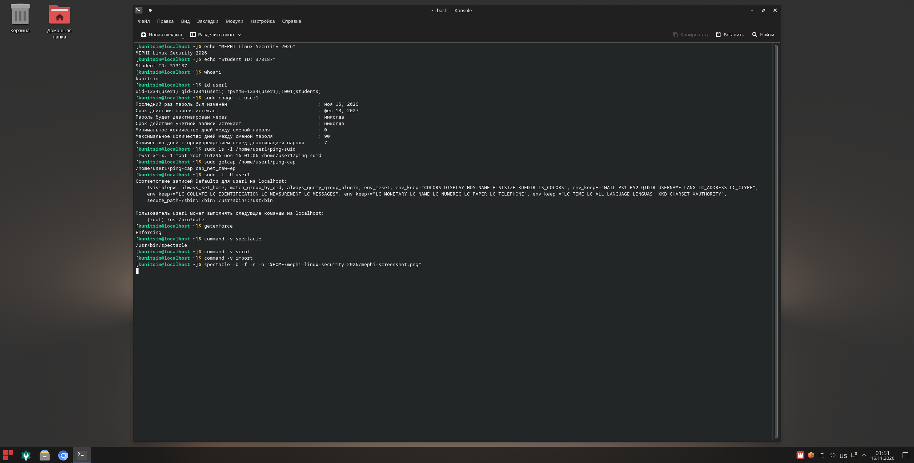

# MEPHI Linux Security 2026

## Исходные данные

- Уникальный номер студента: 373187
- Операционная система: РЕД ОС 8
- Ядро Linux: 6.12.92-1.red80.x86_64
- Архитектура: x86_64
- Среда виртуализации: Oracle VirtualBox
- Основной пользователь: kunitsin
- Учебный пользователь: user1
- SELinux: Enforcing

## Результаты выполнения задания

| Раздел | Выполненные действия | Результат |
|---|---|---|
| 1.1 | Создание пользователя user1 | UID 1234, группа students, срок действия пароля 90 дней |
| 2.1 | Поиск файлов с set-UID | Обнаружен 31 файл на момент проверки |
| 2.2 | Мониторинг процессов | Обнаружены fusermount3 и passwd с RUID 1000 и EUID 0 |
| 3.1 | Выбор утилиты | ping, создание сырого сетевого сокета |
| 3.2 | Настройка set-UID | ping-suid, права 4755, операция успешна |
| 4.1 | Выбор привилегии | CAP_NET_RAW |
| 4.2 | Настройка capabilities | ping-cap, cap_net_raw=ep, операция успешна |
| 5 | Настройка sudo | Разрешено изменение системного времени |
| 6 | Сбор артефактов | Результаты сохранены в файлы |

## Раздел 1. Создание пользователя

Созданы группа students и пользователь user1.

Использованные команды:

    sudo groupadd students
    sudo useradd -m -u 1234 -G students user1
    sudo passwd user1
    sudo chage -M 90 user1
    sudo chage -W 7 user1

Параметры пользователя:

- UID: 1234.
- Основная группа: user1.
- Дополнительная группа: students.
- GID группы students: 1001.
- Домашний каталог: /home/user1.
- Максимальный срок действия пароля: 90 дней.
- Предупреждение о смене пароля: 7 дней.

## Раздел 2. Мониторинг файлов и процессов

### 2.1. Поиск файлов с set-UID

    sudo find / -type f -perm -4000 -print

На момент первоначальной проверки обнаружен 31 файл.
Некоторые объекты виртуальных файловых систем
были недоступны для поиска.

Результат сохранён в suid-files.out.

### 2.2. Мониторинг процессов

    ps -e -o pid,ruid,uid,comm | awk 'NR == 1 || ($2 >= 1000 && $2 <= 60000 && $3 == 0)'

Обнаружены следующие процессы:

| PID | RUID | EUID | Команда |
|---|---|---|---|
| 1232 | 1000 | 0 | fusermount3 |
| 2221 | 1000 | 0 | passwd |

Для исследования был запущен процесс смены пароля
с последующей отменой операции.

Результат сохранён в processes.out.

## Раздел 3. Механизм set-UID

Выбрана утилита ping.

Привилегированная операция — создание сырого
сетевого сокета для отправки ICMP-запросов
на локальный адрес 127.0.0.1.

Учебная копия: /home/user1/ping-suid.

Владелец: root:root.
Права доступа: 4755.
Файловые capabilities отсутствуют.

До установки set-UID операция была запрещена.
После установки set-UID операция выполнена
успешно: отправлено 3 пакета, получено 3,
потери составили 0%.

Дополнительно исследована утилита id-suid.
Подтверждено изменение эффективного UID
с 1234 на 0 при сохранении реального UID 1234.

Артефакты:

- suid-before.out
- suid-after.out
- suid-test.out
- stat.out

## Раздел 4. Linux Capabilities

Выбрана утилита ping.
Учебная копия: /home/user1/ping-cap.

Назначена отдельная привилегия:

    cap_net_raw=ep

Права доступа: 0755.
Бит set-UID отсутствует.

До назначения привилегии создание сырого
сокета завершалось ошибкой.
После назначения операция выполнена успешно.

Отправлено 3 пакета, получено 3,
потери составили 0%.

Артефакты:

- getcap.out
- capabilities-test.out
- stat.out

## Сравнение set-UID и Capabilities

| Параметр | ping-suid | ping-cap |
|---|---|---|
| Права доступа | 4755 | 0755 |
| set-UID | Да | Нет |
| Файловые capabilities | Нет | cap_net_raw=ep |
| Привилегированная операция | Успешно | Успешно |
| Потери пакетов | 0% | 0% |

Механизм capabilities позволяет предоставлять
отдельные полномочия вместо широких привилегий root.
Это соответствует принципу минимальных привилегий.

## Раздел 5. Механизм sudo

Создан файл /etc/sudoers.d/user1-time.

Содержимое правила:

    user1 ALL=(root) /usr/bin/date

Синтаксис конфигурации проверен через visudo.

Результаты эксперимента:

- Изменение времени без sudo запрещено.
- Изменение времени через sudo выполнено успешно.
- Код завершения команды: 0.
- Выполнение /usr/bin/id через sudo запрещено.

Артефакты:

- sudo-test.out
- sudoers-user1-time
- etc/sudoers

## Сохранение настроек

Проведена проверка после перезагрузки РЕД ОС.

Подтверждено сохранение пользователя, групп,
политики паролей, специальных прав доступа,
capabilities и разрешений sudo.

SELinux оставлен в режиме Enforcing.

Результаты сохранены в reboot-check.out.

## Артефакты проекта

| Файл | Назначение |
|---|---|
| mephi-screenshot.png | Скриншот с номером студента |
| history.out | История команд |
| stat.out | Права доступа и владельцы файлов |
| getcap.out | Назначенные capabilities |
| etc/passwd | Запись учебного пользователя |
| etc/shadow | Политика паролей без хеша |
| etc/group | Записи учебных групп |
| etc/sudoers | Правило sudo для user1 |
| suid-files.out | Список файлов с set-UID |
| processes.out | Мониторинг процессов |
| password-policy.out | Политика смены пароля |
| suid-before.out | Проверка до установки set-UID |
| suid-after.out | Проверка после установки set-UID |
| suid-test.out | Проверка эффективного UID |
| capabilities-test.out | Проверка capabilities |
| sudo-test.out | Разрешения sudo |
| sudoers-user1-time | Созданное правило sudo |
| selinux.out | Диагностика SELinux |
| reboot-check.out | Проверка после перезагрузки |

## Безопасность публикации

В публичном репозитории размещены только относящиеся
к заданию извлечения системных конфигурационных файлов.

Хеш пароля в файле etc/shadow заменён на REDACTED.
Оригинальные хеши паролей не публикуются.

Привилегированные учебные копии программ используются
исключительно в учебной виртуальной машине.

## Заключение

В ходе работы изучены механизмы управления
пользователями, мониторинга файлов и процессов,
set-UID, Linux Capabilities и sudo.

Практически подтверждена работоспособность
настроенных механизмов безопасности.

## Скриншот

